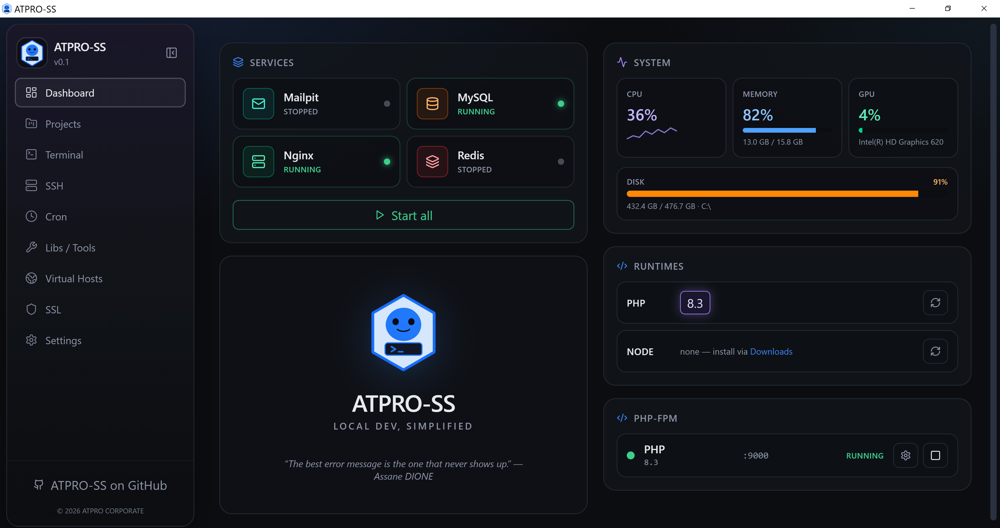
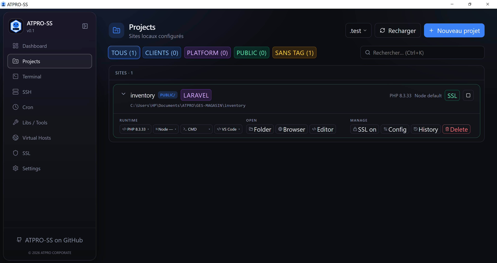
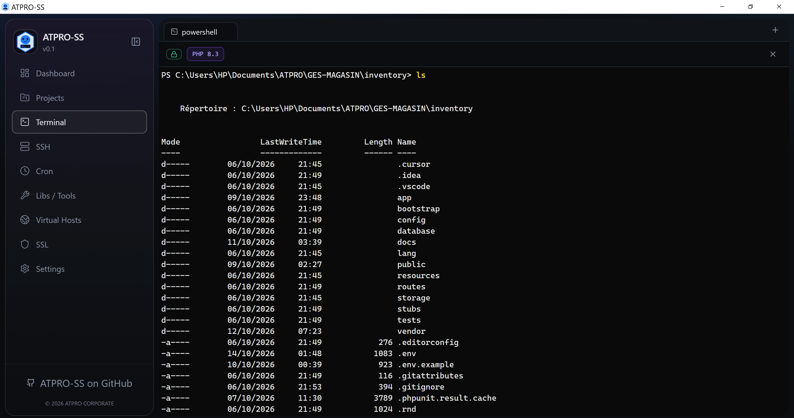
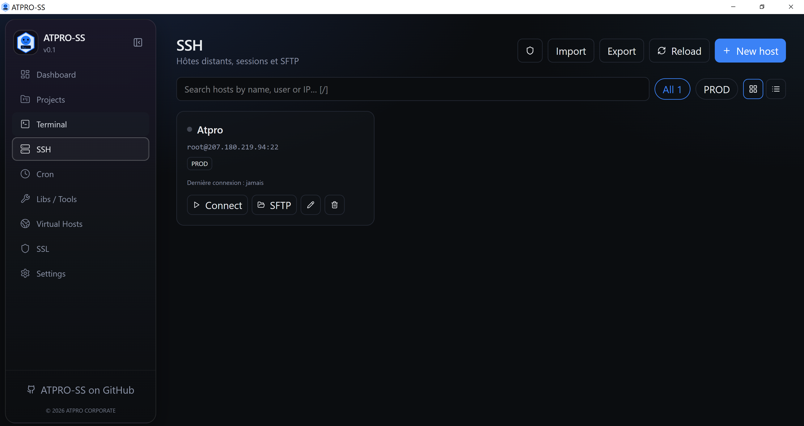
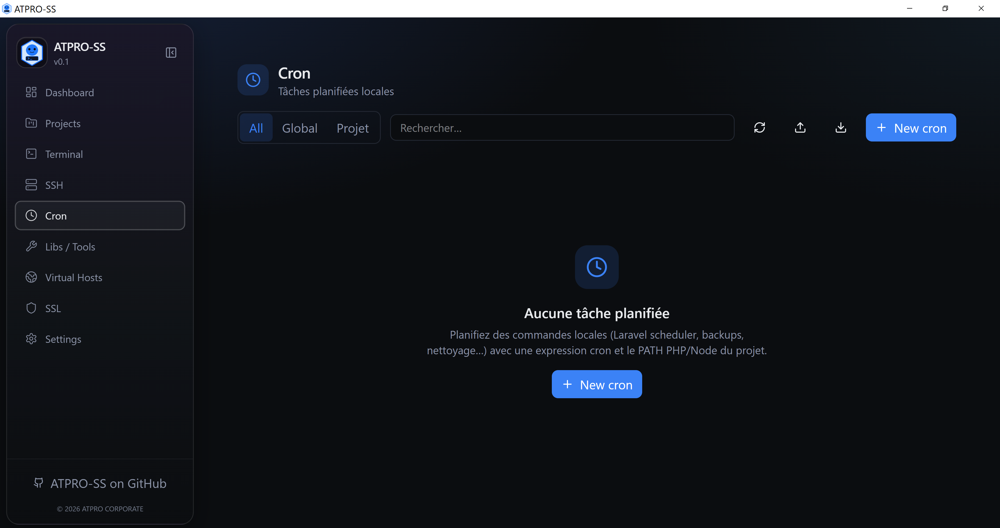
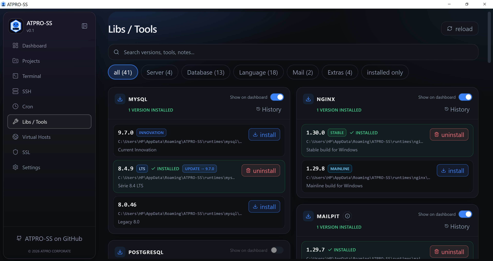
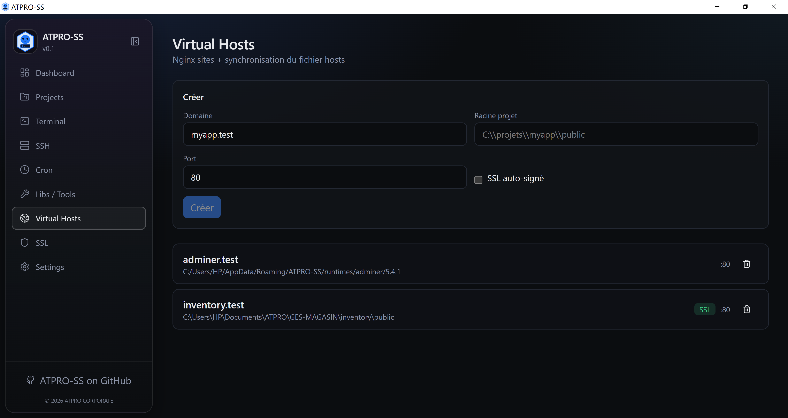
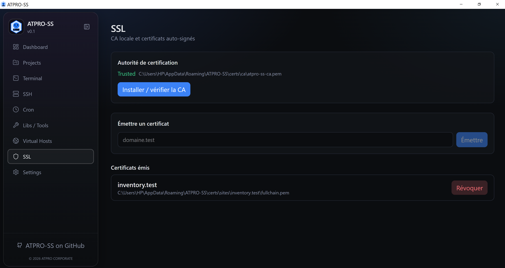
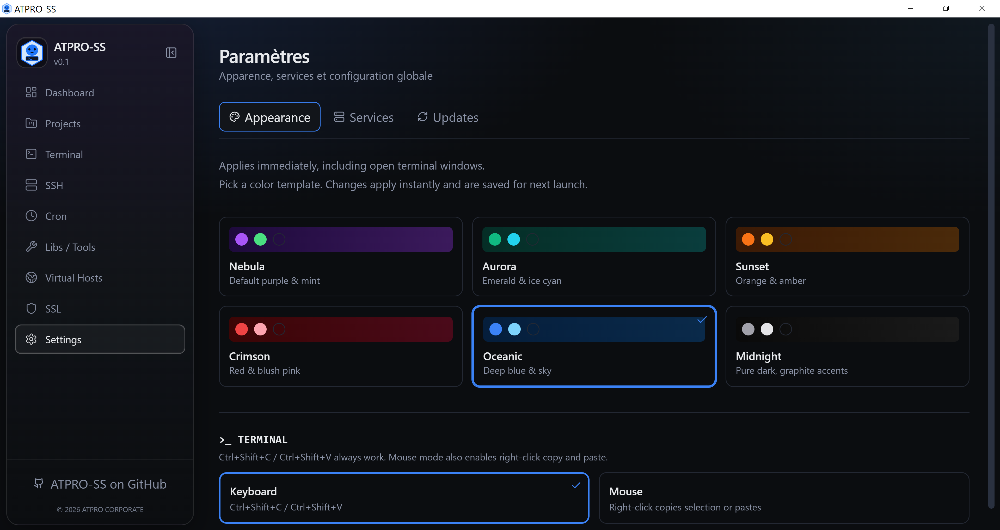

  

<h1 align="center">ATPRO-SS</h1>

  <strong>Environnement de développement web pour Windows.</strong> 
  Une alternative légère à Laragon, XAMPP et WAMP : services locaux, projets, terminal, SSH et cron dans une seule application native. 
  Construit avec <a href="https://v2.tauri.app">Tauri 2</a>, Rust et React. Binaire natif, WebView2, sans Docker, sans WSL, sans Electron.

  
  
  

  <a href="#installation">Installation</a> ·
  <a href="#fonctionnalites">Fonctionnalités</a> ·
  <a href="#visite">Visite</a> ·
  <a href="#demarrage-rapide">Démarrage</a>

  

---

## Pourquoi ATPRO-SS ?

- **Application native Windows** sur WebView2. Les services (Nginx, MySQL, Redis, Mailpit, PHP) sont de vrais processus, pas des conteneurs.
- **Plusieurs versions côte à côte** — PHP et Node s’installent depuis le catalogue, puis se choisissent par projet.
- **Projets détectés automatiquement** — Laravel, Symfony, Next.js, Nuxt, Vite, Vue, React, Angular ou PHP simple, avec le gestionnaire de paquets (npm, pnpm, yarn, bun).
- **Un domaine local par site** — vhost Nginx, entrée `hosts` et certificat signé par une autorité locale.
- **Hosts sans UAC à répétition** — le service Windows `AtproSsHelper` écrit le fichier `hosts` après une seule élévation à l’installation.
- **Mode portable** — un fichier `portable.flag` à côté de l’exécutable garde config, runtimes et projets dans le dossier de l’application.
- **Terminal, SSH et cron intégrés** — shells avec le PATH du projet, client SSH/SFTP, tâches planifiées qui survivent à la fermeture de l’application.

---

<h2 id="installation">Installation</h2>

**Version actuelle : 0.1.0.**

| Édition | Ce que vous obtenez |
|---|---|
| **[Installateur NSIS](https://github.com/as199/atpro-ss/releases/download/v0.1.0/ATPRO-SS_0.1.0_x64-setup.exe)** | Recommandé. Installation machine (`perMachine`), raccourcis, service `AtproSsHelper` et règles de pare-feu du groupe **ATPRO-SS** (ports 80, 443, 3306, 6379, 9000, 8025). Demande les droits administrateur **une seule fois**. |
| **[Installateur MSI](https://github.com/as199/atpro-ss/releases/download/v0.1.0/ATPRO-SS_0.1.0_x64_en-US.msi)** | Même application, sans l’installation automatique du Helper. Préférez le NSIS si vous voulez l’écriture du fichier `hosts` sans nouvelle invite UAC. |

**Données.** En mode installé, la racine est `%APPDATA%\ATPRO-SS`. En développement et en mode portable, elle est le dossier de l’application. Projets, certificats, logs et configuration y survivent à une mise à jour de l’exécutable.

**Mises à jour.** Settings → Updates interroge le canal signé Ed25519 :
- `https://github.com/as199/atpro-ss/releases/latest/download/latest.json`
- fallback : [`updates/latest.json`](./updates/latest.json) sur cette branche `master`

Voir [`updates/README.md`](./updates/README.md) pour republier le manifeste.

**Prérequis :** Windows 10 21H2+ ou Windows 11, x64 · WebView2 (déjà présent sur ces versions) · droits administrateur au premier lancement de l’installateur NSIS, pour le Helper et le fichier `hosts`.

Au premier lancement, l’application propose d’installer la pile **Nginx 1.30**, **MySQL 8.4** et **Redis**. PHP et Node s’ajoutent ensuite depuis **Libs / Tools**.

---

<h2 id="fonctionnalites">Fonctionnalités</h2>

| | |
|---|---|
| 📊 **Dashboard** | État de Nginx, MySQL, Redis, Mailpit et PHP. **Start all**, démarrage individuel, et un moniteur CPU, mémoire, disque et GPU rafraîchi toutes les 2 secondes. Nginx et PHP démarrent tout seuls à l’ouverture si le web doit servir les vhosts. |
| 🚀 **Runtimes** | Plusieurs versions de PHP et de Node installées en parallèle. La version active est visible sur le dashboard et injectée dans le PATH du terminal. |
| 📁 **Projets** | Import d’un dossier, projet vide, `composer create-project` Laravel, ou clone Git. Recherche, tags, suffixe de domaine (`.test`, `.local`, `.dev`, `.localhost` ou personnalisé). |
| 🔎 **Détection** | Type lu depuis `composer.json` et `package.json` : Laravel, Symfony, Next.js, Nuxt, Vue, React, Angular, Vite, PHP simple. Gestionnaire : npm, pnpm, yarn ou bun. |
| ▶️ **Dev & files** | Démarrage du serveur de dev du projet, logs en direct, workers de queue (commande, nombre de workers, démarrage auto) et alerte si un port est déjà pris. |
| 🌐 **Virtual hosts** | Site Nginx + ligne dans le fichier `hosts` Windows. Domaine, racine, port et SSL. Le Helper évite une invite UAC à chaque écriture. |
| 🔐 **SSL local** | Autorité de certification locale, installation dans le magasin Windows, émission et révocation d’un certificat par domaine. Bascule SSL par projet. |
| 💻 **Terminal** | xterm.js sur un vrai shell Windows. Onglets PowerShell, CMD, Git Bash et Cmder. Le PATH de la session contient le PHP et le Node du projet. Copier-coller au clavier ou à la souris. |
| 🔌 **SSH** | Hôtes avec tags, recherche, vue grille ou liste. Clés **Ed25519**, **RSA-4096** et **ECDSA P-256**, import de clé, `known_hosts`, test de connexion, **ProxyJump**, session interactive et navigateur **SFTP**. Import et export de la config. |
| ⏰ **Cron** | Expressions à 5 champs, presets (chaque minute, 5 min, 15 min, heure, 03:00, scheduler Laravel). Scope global ou projet, répertoire de travail, PATH du projet. Historique et sortie. Option **exécuter même si ATPRO-SS est fermé**, via le Planificateur de tâches Windows et `LaraEnvRunner.exe`. |
| 🧩 **Libs / Tools** | Catalogue : Nginx, Apache, Caddy, MySQL, PostgreSQL, pgvector, Redis, PHP, Node.js, Python, Composer, Mailpit, Adminer, Cmder. Recherche, filtres, installation avec progression, désinstallation, badge de mise à jour et interrupteur « afficher sur le dashboard ». |
| ⚙️ **Réglages services** | Nginx (`client_max_body_size`, timeouts, `worker_connections`, tailles de hash), limites PHP (`upload_max_filesize`, `post_max_size`, `memory_limit`, workers), directives Apache, extensions PHP, dossier `www` et versions PHP/Node par défaut. |
| 🎨 **6 thèmes** | Nebula, Aurora, Sunset, Crimson, Oceanic, Midnight. Le thème s’applique tout de suite, y compris aux couleurs du terminal. |
| 📨 **Mailpit** | SMTP local `127.0.0.1:1025`, interface web sur [http://localhost:8025](http://localhost:8025). Aucun mail ne sort sur Internet. |

---

<h2 id="visite">Visite</h2>

### Dashboard

Le tableau de bord montre les services que vous avez choisi d’afficher, les runtimes installés, les pools PHP et la charge machine. **Start all** lance ce qui est arrêté. Un clic sur une carte démarre ou arrête ce service.

Les services pilotés depuis le cœur de l’application sont **Nginx**, **MySQL**, **Redis**, **Mailpit** et **PHP**. Le moniteur affiche le CPU, la mémoire, le GPU et le disque. La version PHP active et le port PHP-FPM (par exemple `:9080`) restent visibles à droite.

  

### Projets

Chaque ligne affiche le nom, le chemin, le framework détecté, le domaine et les tags. La recherche couvre le nom, le slug, le chemin, le framework et les tags. Les filtres isolent un tag, ou les projets sans tag.

Raccourcis sur la page Projets :

| Touche | Action |
|---|---|
| `Ctrl+K` | Recherche |
| `Ctrl+N` | Nouveau projet |
| `Ctrl+R` | Recharger la liste |
| `↑` / `↓` | Changer la sélection |
| `Entrée` | Ouvrir ou fermer le détail |
| `O` | Ouvrir le projet dans le navigateur |
| `L` | Ouvrir les logs de dev |

Le détail d’un projet permet de choisir PHP, Node, le shell et l’éditeur (VS Code, Cursor, et les éditeurs détectés sur la machine), puis d’ouvrir le dossier, le navigateur ou l’éditeur. SSL, configuration, historique et suppression (avec nettoyage du vhost, du `hosts`, du certificat et des données) sont au même endroit.

Créer un projet se fait en deux étapes :

1. **Source** — dossier existant, dossier vide, Laravel, ou clone Git.
2. **Identité** — nom, chemin, tags, domaine, port, SSL, versions PHP et Node.

Le domaine suit le suffixe global (`.test` par défaut).

  

### Terminal

Un onglet est une session réelle. Le badge de la barre indique si le PATH des runtimes est injecté, et quelles versions de PHP et de Node sont actives. Ouvrir le terminal depuis un projet place le répertoire courant sur ce projet et sélectionne son shell. PowerShell, CMD, Git Bash et Cmder sont disponibles.

Le mode de copie se règle dans **Paramètres → Apparence** :

- **Clavier** — `Ctrl+Shift+C` / `Ctrl+Shift+V`
- **Souris** — le clic droit copie la sélection ou colle

  

### SSH

La page est vide tant qu’aucun hôte n’est enregistré. **Nouvel hôte** enregistre le nom, l’adresse, l’utilisateur, le port, la méthode d’authentification (clé, mot de passe, ou les deux) et, si besoin, un **ProxyJump**. Le test de connexion se fait avant d’enregistrer.

Une session s’ouvre dans l’application. Le navigateur SFTP liste, crée et supprime des fichiers sur l’hôte. Les clés générées (Ed25519, RSA-4096, ECDSA P-256) restent dans le dossier `ssh` de la racine ATPRO-SS. `known_hosts` se consulte et se nettoie depuis la même page. La recherche, les tags et l’import / export de la configuration sont sur cette page.

  

### Cron

Une tâche a un nom, une expression, une commande, un scope (global ou un projet) et un répertoire de travail. L’expression à 5 champs est validée en direct, avec les cinq prochaines exécutions. Les filtres **All**, **Global** et **Projet** isolent les tâches. Le preset **Laravel scheduler** préremplit `php artisan schedule:run` chaque minute, avec le PATH PHP du projet.

**Exécuter lorsque ATPRO-SS est fermé** enregistre la tâche dans le Planificateur Windows. Le lanceur `LaraEnvRunner.exe` réévalue l’expression. L’historique et la sortie standard de chaque run restent consultables dans l’application. L’import et l’export passent par un fichier JSON.

  

### Libs / Tools

Le catalogue est filtré par **Server**, **Database**, **Language**, **Mail** et **Extras**, avec une recherche et une option « installés seulement ». Chaque carte liste les versions, le chemin d’installation et l’état. La barre de progression suit le téléchargement et l’extraction. L’historique des installations s’ouvre dans un tiroir. L’interrupteur **Show on dashboard** choisit les services affichés sur le tableau de bord.

Le catalogue couvre Nginx, Apache, Caddy, MySQL, PostgreSQL, pgvector, Redis, PHP, Node.js, Python, Composer, Mailpit, Adminer et Cmder. Apache, dont l’éditeur ne permet pas toujours un téléchargement direct, peut s’installer depuis une archive locale.

  

### Virtual Hosts

**Virtual Hosts** crée un site Nginx (domaine, racine, port, SSL) et synchronise `C:\Windows\System32\drivers\etc\hosts`. Le service `AtproSsHelper` évite une invite UAC à chaque écriture.

  

### SSL

**SSL** affiche l’autorité locale (chemin du certificat, confiance Windows), permet de l’installer, d’émettre un certificat pour un domaine et de le révoquer. La même autorité est exposée dans **Paramètres → Services → HTTPS local**, où elle peut aussi être révoquée.

  

### Paramètres

- **Apparence** — un des six thèmes (Nebula, Aurora, Sunset, Crimson, Oceanic, Midnight), et le mode copier-coller du terminal. Le changement s’applique tout de suite, y compris aux fenêtres de terminal déjà ouvertes.
- **Services** — CA locale, directives Nginx, limites PHP et extensions, directives Apache, dossier des sites et versions PHP/Node par défaut. La télémétrie est désactivée tant que vous ne l’activez pas.
- **Updates** — affiche la version installée (`0.1.0`). Le canal de mise à jour automatique n’est pas encore branché : la vérification indique que vous êtes à jour.

  

---

<h2 id="demarrage-rapide">Démarrage rapide</h2>

1. Installez ATPRO-SS (NSIS) ou lancez `atpro-ss.exe` avec un `portable.flag` à côté.
2. Au premier écran, laissez l’installation de **Nginx**, **MySQL** et **Redis** se terminer.
3. Ouvrez **Libs / Tools** et installez les versions de **PHP** et **Node** dont vous avez besoin.
4. Sur le **Dashboard**, démarrez les services. Nginx et PHP partent aussi seuls si les vhosts doivent répondre.
5. **Projects → New project**. Importez un dossier ou créez un Laravel. Le vhost, l’entrée `hosts` et le certificat sont préparés avec le projet.
6. Ouvrez `https://votre-projet.test`.

Pour capter les e-mails d’une app Laravel, démarrez **Mailpit** puis voir sa configuration dans Libs/Tools. Le SMTP local est `127.0.0.1:1025`, l’interface web est sur [http://localhost:8025](http://localhost:8025).

---

## Stack

| Couche | Technologie |
|---|---|
| Desktop | Tauri 2, WebView2 |
| Cœur | Rust (Tokio, gestion de processus, CA locale) |
| Interface | React 19, TypeScript, Vite 6, Tailwind CSS 4, Zustand, TanStack Query |
| Terminal | xterm.js |
| Service Windows | `AtproSsHelper` (compte LocalSystem, tube nommé) |

---

## Statut

Version **0.1.0**, en usage de développement. Les retours (bugs, captures, demandes) sont les bienvenus sur le dépôt [atpro_ss](https://github.com/as199/atpro-ss).

© ATPRO CORPORATE
